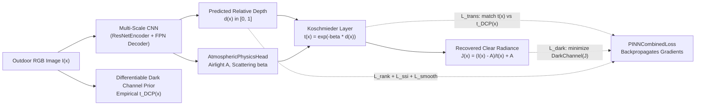
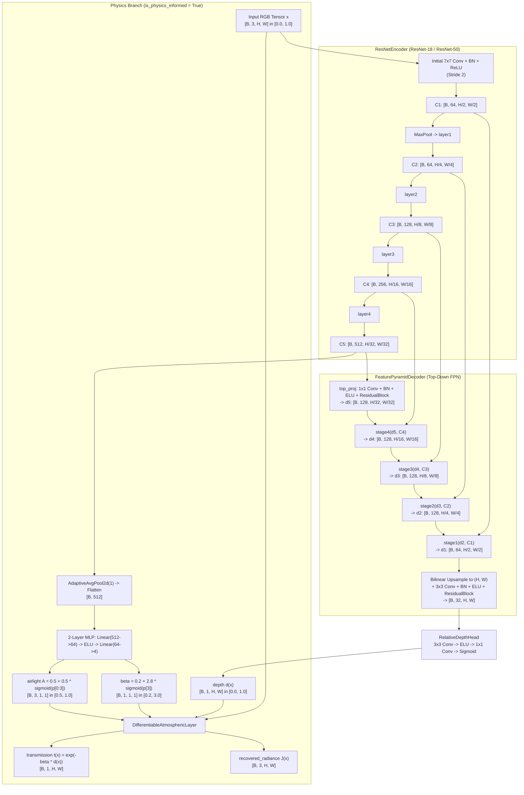
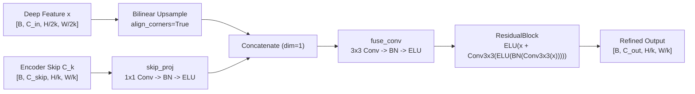
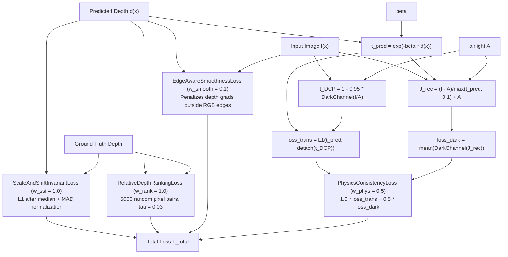
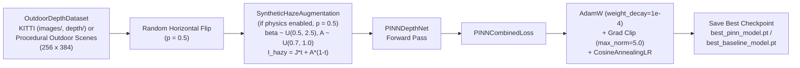
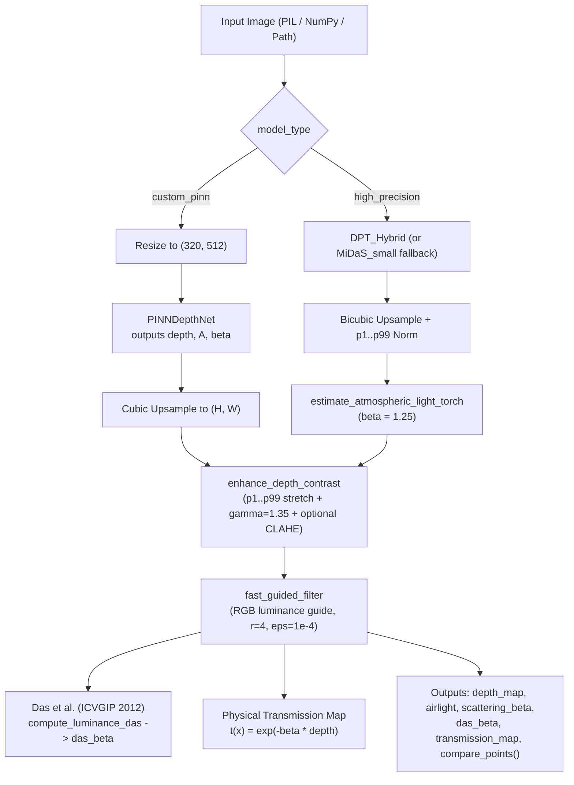

# PINN-Depth: Physics-Informed Relative Monocular Depth Estimation

**PINN-Depth** is a Physics-Informed Neural Network (PINN) for **single-image (monocular) relative depth estimation** in outdoor scenes. It embeds the physical laws of **atmospheric light scattering** directly into the network forward pass, training augmentations, loss functions, and post-processing pipeline.

---

## 1. Core Concept: How Physics + Deep Learning Work Together

Predicting depth from a single RGB photo is mathematically ambiguous because a 2D image loses absolute 3D scale. In outdoor environments, however, the atmosphere acts as a continuous optical rangefinder:

- **Near objects ($d \to 0$)**: Light travels a short path to the camera, preserving high local contrast, saturated colors, and dark shadows.
- **Distant objects ($d \to 1$)**: Light is exponentially attenuated by air molecules/aerosols and blended with ambient sky illumination (**airlight** $A$), causing contrast loss and hazy shifts.

**PINN-Depth** turns this physical phenomenon into a differentiable learning loop:



Rather than treating depth prediction as pure pixel regression, the network must satisfy **both** geometric ordering constraints and atmospheric scattering physics.

---

## 2. Complete Model Architecture (`PINNDepthNet`)

Implemented in [`pinn_depth/models/pinn_net.py`](pinn_depth/models/pinn_net.py), [`encoder.py`](pinn_depth/models/encoder.py), and [`decoder.py`](pinn_depth/models/decoder.py).

### 2.1 End-to-End Architecture Flowchart



*(Note: Channel sizes shown above are for the default `resnet18` backbone; `resnet50` outputs `[64, 256, 512, 1024, 2048]`.)*

### 2.2 Multi-Scale Encoder (`ResNetEncoder`)

| Stage | Spatial Stride | Tensor Shape (`resnet18`) | Tensor Shape (`resnet50`) | Visual Role in Depth Estimation |
| :--- | :--- | :--- | :--- | :--- |
| **`C1`** | `/ 2` | `[B, 64, H/2, W/2]` | `[B, 64, H/2, W/2]` | Fine edges, leaf contours, surface textures |
| **`C2`** | `/ 4` | `[B, 64, H/4, W/4]` | `[B, 256, H/4, W/4]` | Local shapes and sharp object boundaries |
| **`C3`** | `/ 8` | `[B, 128, H/8, W/8]` | `[B, 512, H/8, W/8]` | Object parts and mid-level geometry |
| **`C4`** | `/ 16` | `[B, 256, H/16, W/16]` | `[B, 1024, H/16, W/16]` | Semantic regions (roads, cars, trees, buildings) |
| **`C5`** | `/ 32` | `[B, 512, H/32, W/32]` | `[B, 2048, H/32, W/32]` | Global scene layout, sky, horizon, and haze density |

### 2.3 Inside Each `DecoderStage` & `ResidualBlock`

Every stage in `FeaturePyramidDecoder` fuses coarse semantic depth reasoning with crisp encoder skip edges before refining boundaries with a residual block:



- **Why `ELU` instead of `ReLU`?** Smooth negative activations prevent "dead neuron" plateaus across continuous depth gradients.
- **Why `align_corners=True` bilinear interpolation?** Keeps spatial coordinates cleanly aligned when merging multi-scale feature grids without checkerboard artifacts from transposed convolutions.

### 2.4 Prediction Heads & Physics Layer

| Component | Architecture | Output & Bounds | Meaning |
| :--- | :--- | :--- | :--- |
| **`RelativeDepthHead`** | `Conv3x3(32→16)` → `ELU` → `Conv1x1(16→1)` → `Sigmoid` | `depth`: `[B, 1, H, W]` in `[0.0, 1.0]` | `0.0` = nearest foreground, `1.0` = farthest background/sky |
| **`AtmosphericPhysicsHead`** | `AdaptiveAvgPool2d(1)` → `Linear(C5→64)` → `ELU` → `Linear(64→4)` | `airlight`: `[B, 3, 1, 1]` in `[0.5, 1.0]`<br>`beta`: `[B, 1, 1, 1]` in `[0.2, 3.0]` | Global sky illumination color $A$ and atmospheric attenuation $\beta$ |
| **`DifferentiableAtmosphericLayer`** | Closed-form Koschmieder equations (`eps = 1e-4`) | `transmission`: `[B, 1, H, W]`<br>`recovered_radiance`: `[B, 3, H, W]` | $t(x) = \text{clamp}(e^{-\beta d(x)}, 10^{-4}, 1.0)$<br>$J(x) = \text{clamp}(\frac{I(x) - A}{\max(t(x), 10^{-4})} + A, 0, 1)$ |

---

## 3. Under-the-Hood Physics Modules

### 3.1 Koschmieder's Atmospheric Scattering Law (`pinn_depth/physics/scattering.py`)

Outdoor light transport through a homogeneous atmosphere obeys Koschmieder's equation:

$$I(x) = J(x)\,t(x) + A\,(1 - t(x)), \qquad t(x) = \exp(-\beta\,d(x))$$

| Quantity | Symbol | Near Object ($d \to 0$) | Far Object ($d \to 1$) |
| :--- | :---: | :--- | :--- |
| **Transmission** | $t(x)$ | $\approx 1.0$ (direct light dominates) | $\approx e^{-\beta}$ (heavily attenuated) |
| **Observed Pixel** | $I(x)$ | $\approx J(x)$ (true clear surface) | Blended toward atmospheric airlight $A$ |
| **Inverse Dehazing** | $J(x)$ | Minimal amplification needed | Recovers intrinsic scene color via $(I - A)/t + A$ |

Because $t(x)$ and $J(x)$ are implemented purely with differentiable PyTorch operations, errors in recovered radiance or transmission flow backward to refine `depth`, `airlight`, and `beta` end-to-end.

### 3.2 Differentiable Dark Channel Prior (`pinn_depth/physics/dark_channel.py`)

From He et al. (2010), in almost every non-sky outdoor patch $\Omega(x)$, at least one RGB channel contains very low intensity values when haze is absent:

$$J_{\text{dark}}(x) = \min_{c \in \{R,G,B\}} \left( \min_{y \in \Omega(x)} I^c(y) \right)$$

To keep this operator fast and **fully differentiable** on GPU/CPU without Python loops:
1. Take the per-pixel channel minimum: `min_channel = torch.min(image, dim=1, keepdim=True)`.
2. Compute the local patch minimum (`patch_size=15`) via inverted max pooling:
   `dark_channel = -F.max_pool2d(-min_channel, kernel_size=15, stride=1, padding=7)`.
3. **Airlight Estimation (`estimate_atmospheric_light_torch`)**: selects the top $0.1\%$ (`top_percent=0.001`) brightest pixels in `dark_channel`, chooses the one with maximum RGB mean intensity, and clamps to $[0.5, 1.0]$.
4. **Coarse Physical Transmission (`estimate_transmission_dcp`)**:
   $$t_{\text{DCP}}(x) = \text{clamp}\!\left(1 - \omega \cdot \min_{c}\min_{y \in \Omega(x)} \frac{I^c(y)}{\max(A^c, 10^{-3})},\ 0.05,\ 1.0\right), \quad \omega = 0.95$$

### 3.3 Das et al. (ICVGIP 2012) Physics & Guided Filtering (`pinn_depth/physics/das_physics.py`)

Implements empirical outdoor scattering analysis from *Das, Biswas & Saha (ICVGIP 2012)* and edge-guided spatial refinement:

- **Luminance Projection**: $C(x, y) = 0.33\,R + 0.56\,G + 0.11\,B$ (clipped to $[1, 255]$).
- **Empirical Attenuation $\beta$ (Equations 8 & 19)**, with global maximum airlight luminance $C_{gm} = \max(\text{percentile}_{99.5}(C),\ 180.0)$:
  $$\tilde{C}(x, y) = C(x, y)\left(2 - \frac{C}{C_{gm}}\right) - C_{gm}\left(1 - \frac{C}{C_{gm}}\right)$$
  $$\beta(x, y) = -\sqrt{\frac{C}{C_{gm}}}\,\ln\!\left(\frac{C}{\tilde{C}}\right)$$
  The scene attenuation scalar `das_beta` is taken as the median over positive pixels (clipped to $[0.25, 0.65]$).
- **Fast Guided Image Filter (`fast_guided_filter`, He et al.)**: fits local linear models $q = \bar{a}\,I + \bar{b}$ over local box windows (`radius=4, eps=1e-4` during inference) between the grayscale RGB image $I$ and predicted depth $P$. This transfers razor-sharp high-frequency contours (petals, branches, building edges) directly into the depth map without blurring across depth boundaries.

---

## 4. Multi-Task Training Objective (`PINNCombinedLoss`)

Implemented in [`pinn_depth/physics/losses.py`](pinn_depth/physics/losses.py). Total training loss is a weighted sum of four objectives:

$$\mathcal{L}_{\text{total}} = w_{\text{rank}}\,\mathcal{L}_{\text{rank}} + w_{\text{phys}}\,\mathcal{L}_{\text{phys}} + w_{\text{ssi}}\,\mathcal{L}_{\text{ssi}} + w_{\text{smooth}}\,\mathcal{L}_{\text{smooth}}$$



### Detailed Loss Formulas

1. **Pairwise Ordinal Ranking Loss (`RelativeDepthRankingLoss`)**:
   Samples up to `5000` valid pixel pairs $(p_0, p_1)$ per image with difference threshold $\tau = 0.03$:
   $$\mathcal{L}_{\text{rank}} = \begin{cases} \log\big(1 + \exp(-l \cdot (d_0 - d_1))\big), & |gt_0 - gt_1| > \tau,\quad l = \text{sign}(gt_0 - gt_1) \\ (d_0 - d_1)^2, & |gt_0 - gt_1| \le \tau \end{cases}$$
   Directly optimizes relative ordering (*which point is closer?*).

2. **Scale-and-Shift Invariant Loss (`ScaleAndShiftInvariantLoss`)**:
   Removes arbitrary scale/offset differences via robust statistics over valid pixels:
   $$\hat{p} = \frac{p - \text{median}(p)}{\text{MAD}(p) + \epsilon}, \qquad \hat{t} = \frac{t - \text{median}(t)}{\text{MAD}(t) + \epsilon}, \qquad \mathcal{L}_{\text{ssi}} = \text{mean}(|\hat{p} - \hat{t}|)$$

3. **Physics Consistency Loss (`PhysicsConsistencyLoss`)**:
   Enforces physical realism with weights $\lambda_{\text{trans}} = 1.0,\ \lambda_{\text{dark}} = 0.5$:
   $$\mathcal{L}_{\text{phys}} = \lambda_{\text{trans}}\,\|t_{\text{pred}} - \text{detach}(t_{\text{DCP}})\|_1 + \lambda_{\text{dark}}\,\text{mean}\big(J_{\text{dark}}(J_{\text{recovered}})\big)$$

4. **Edge-Aware Smoothness Loss (`EdgeAwareSmoothnessLoss`)**:
   Suppresses noisy depth fluctuations inside flat surfaces while allowing sharp discontinuities across object boundaries ($\alpha = 10.0$):
   $$\mathcal{L}_{\text{smooth}} = \text{mean}\!\left(|\partial_x d|\,e^{-\alpha |\partial_x I|}\right) + \text{mean}\!\left(|\partial_y d|\,e^{-\alpha |\partial_y I|}\right)$$

---

## 5. End-to-End Training & Inference Pipelines

### 5.1 Training & Synthetic Haze Augmentation (`train.py`, `kitti_dataset.py`, `synthetic_haze.py`)



- **Why inject synthetic haze during training?** Given clear image $J$ and known depth $d$, Koschmieder's forward equation generates physically exact hazy observations $I_{\text{hazy}}$ without changing ground-truth depth $d$—teaching the network haze invariance.

### 5.2 Inference & Post-Processing Pipeline (`pinn_depth/inference.py`)



- **ONNX Support**: `DepthInferenceEngine.export_to_onnx()` exports `PINNDepthNet` (opset 14) with dynamic batch, height, and width axes for lightweight CPU deployment.

---

## 6. Ablation Study & Evaluation (`pinn_depth/evaluate.py`)

To isolate the impact of physics guidance, the exact same ResNet-FPN architecture can be trained and evaluated in two modes under heavy synthetic haze (`haze_prob = 0.8`):

| Feature | CNN Baseline (`--baseline`) | PINN-Depth (Ours) |
| :--- | :---: | :---: |
| `ResNetEncoder` + `FeaturePyramidDecoder` + `RelativeDepthHead` | Yes | Yes |
| `AtmosphericPhysicsHead` ($A, \beta$) & `DifferentiableAtmosphericLayer` | No | Yes |
| Supervised losses ($\mathcal{L}_{\text{rank}} + \mathcal{L}_{\text{ssi}} + \mathcal{L}_{\text{smooth}}$) | Yes | Yes |
| Self-supervised `PhysicsConsistencyLoss` ($w_{\text{phys}} = 0.5$) | No (`w_phys = 0.0`) | Yes |
| On-the-fly `SyntheticHazeAugmentation` | No | Yes |

**Benchmark Metrics** (computed after least-squares scale-and-shift alignment $t \approx s \cdot p + b$):
- **`OrdAcc`**: Pairwise relative ordering accuracy across 5,000 random pixel pairs (`margin_tau = 0.03`).
- **`AbsRel`**: Mean absolute relative error.
- **`RMSE`**: Root mean squared error.
- **`SILog`**: Scale-invariant logarithmic error ($\times 100$).
- **`delta1`**: Fraction of pixels satisfying $\max(p/t,\ t/p) < 1.25$.

---

## 7. Repository Structure & Commands

```text
pinn_depth/
├── models/
│   ├── encoder.py          # ResNetEncoder (multi-scale C1..C5 extraction)
│   ├── decoder.py          # FeaturePyramidDecoder, DecoderStage, ResidualBlock
│   └── pinn_net.py         # PINNDepthNet, RelativeDepthHead, AtmosphericPhysicsHead, DifferentiableAtmosphericLayer
├── physics/
│   ├── scattering.py       # Koschmieder forward synthesis & inverse radiance recovery
│   ├── dark_channel.py     # Differentiable Dark Channel Prior, airlight & t_DCP
│   ├── das_physics.py      # Das et al. (ICVGIP 2012) luminance/beta, fast guided filter, colormaps
│   └── losses.py           # PINNCombinedLoss (Ranking, SSI, PhysicsConsistency, Smoothness)
├── dataset/
│   ├── kitti_dataset.py    # OutdoorDepthDataset (KITTI depth & procedural fallback)
│   └── synthetic_haze.py   # On-the-fly Koschmieder atmospheric haze augmentation
├── train.py                # Training script (PINN & --baseline ablation)
├── evaluate.py             # Hazy/clear quantitative benchmark suite
└── inference.py            # DepthInferenceEngine, point comparison & ONNX export
```

### Quick Commands

```bash
# 1. Install dependencies and package
pip install -r requirements.txt
pip install -e .

# 2. Train Physics-Informed CNN
python pinn_depth/train.py --epochs 15 --batch-size 4 --backbone resnet18

# 3. Train CNN Baseline (ablation without physics components)
python pinn_depth/train.py --epochs 15 --batch-size 4 --backbone resnet18 --baseline

# 4. Evaluate and compare PINN vs. Baseline
python pinn_depth/evaluate.py --pinn-ckpt checkpoints/best_pinn_model.pt --baseline-ckpt checkpoints/best_baseline_model.pt

# 5. Export PINNDepthNet to ONNX
python -c "from pinn_depth.inference import DepthInferenceEngine; DepthInferenceEngine(model_type='custom_pinn').export_to_onnx('pinn_depth.onnx')"

# 6. Run test suite
pytest
```
